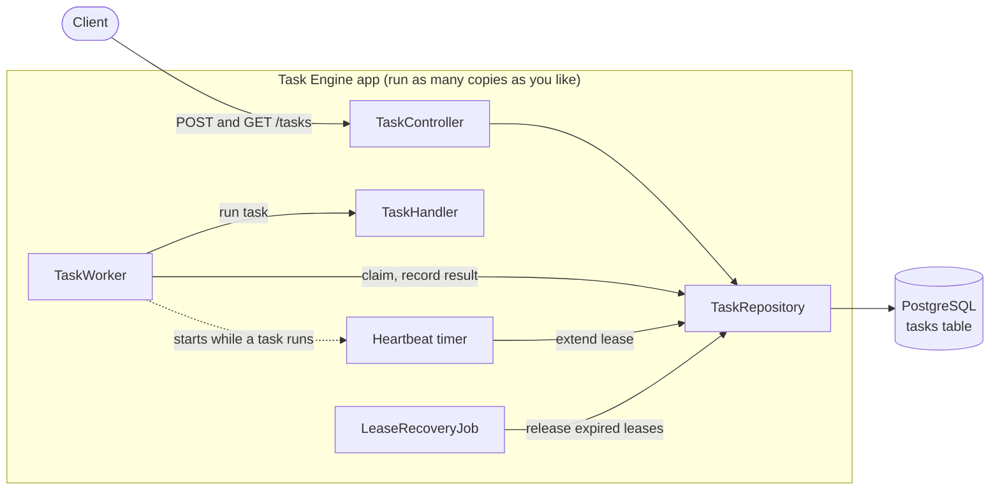

# Task Engine

A distributed task execution engine in Java. Clients submit tasks over a REST API, and workers claim them from PostgreSQL, run them, and handle failures: retries with exponential backoff, a dead state for tasks that keep failing, and automatic recovery of tasks whose worker crashed or stalled. Several copies of the app can run at the same time against one database.

Built with Java 25, Spring Boot, PostgreSQL, Flyway, and Testcontainers.

## Features

- **REST API** to submit (`POST /tasks`) and inspect (`GET /tasks/{id}`) tasks, with JSON payloads and request validation.
- **PostgreSQL as the queue.** Workers claim tasks with `SELECT ... FOR UPDATE SKIP LOCKED`, so several workers never take the same task.
- **Retries with exponential backoff** (2s, 4s, 8s, ...), and a `DEAD` state once a task has used all its attempts.
- **Leases and heartbeats.** A claimed task is leased to one worker, and the worker keeps extending the lease while it runs. If the worker dies, the lease expires and a recovery job puts the task back in the queue.
- **Ownership checks.** A worker that has lost its task cannot overwrite the new owner's result, and it logs a warning.
- **Tested.** Automated tests run against a real PostgreSQL in Docker, including eight workers racing for 200 tasks, and the build runs on every push with GitHub Actions.

## Architecture

Every copy of the app runs the same five parts: the API accepts tasks, the worker runs them, a heartbeat timer keeps the lease on a running task alive, and a recovery job releases tasks whose lease expired. All coordination goes through PostgreSQL, so the copies never talk to each other, and adding capacity means starting another copy.